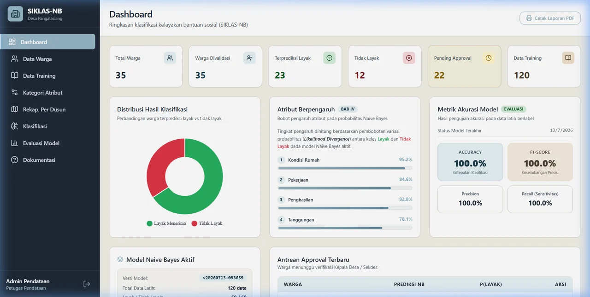
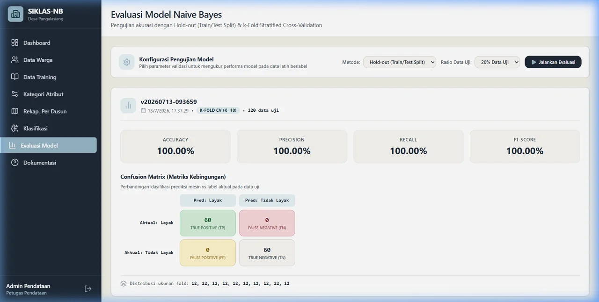

# SIKLAS-NB — Klasifikasi Bantuan Sosial (Naive Bayes)

Implementasi **Naive Bayes Classifier** berbasis Laravel 13 + Vue 3 SPA untuk mendukung keputusan kelayakan penerima bantuan sosial di **Desa Pangalasiang, Kecamatan Sojol, Kabupaten Donggala**.

[](https://siklas.pinnhost.my.id/)


<table>
  <tr>
    <td width="50%"></td>
    <td width="50%"></td>
  </tr>
</table>

### Kapabilitas Utama

- **Engine Naive Bayes Terkalibrasi** — Menghitung probabilitas kelayakan beserta pembobotan atribut berpengaruh (*Likelihood Divergence*).
- **Evaluasi Model Lengkap** — Dukungan *Hold-out Split* dan *Stratified k-Fold Cross-Validation* (`Accuracy`, `Precision`, `Recall`, `F1-Score`, Confusion Matrix).
- **Workflow Desa End-to-End** — Impor massal CSV/XLSX, antrean persetujuan Kepala Desa/Sekdes, galeri rumah warga, hingga laporan PDF rekapitulasi per dusun.

### Struktur Monorepo & Menjalankan

```bash
# Backend API (:8000)
cd backend && composer install && cp .env.example .env && php artisan migrate --seed && php artisan serve

# Frontend SPA (:5173)
cd frontend && npm install && npm run dev
```

Referensi arsitektur & spesifikasi lengkap berada di [`docs/`](docs/CONTEXT.md).
